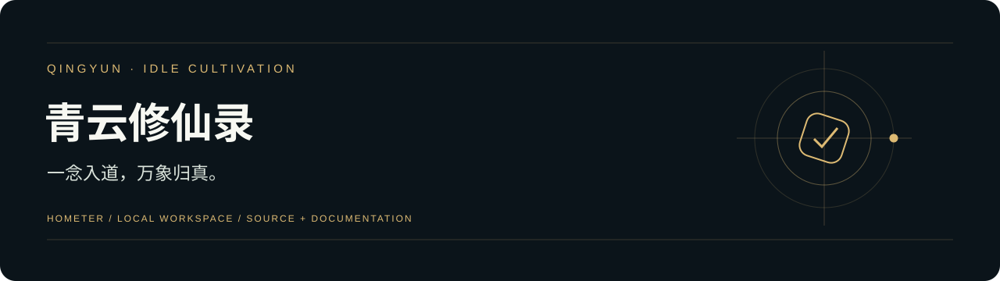
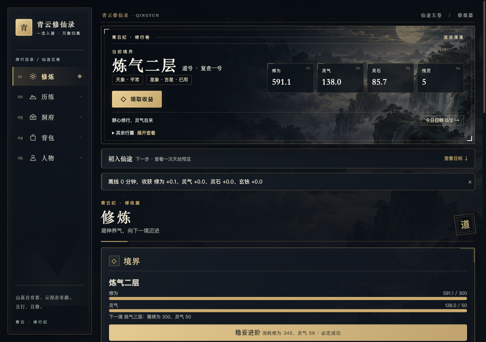

<div align="center">



# 青云修仙录

**一念入道，万象归真。**

[快速开始](#快速开始) · [配置说明](docs/配置说明.md) · [文档导航](docs/README.md) · [项目状态](docs/项目状态.md)

</div>

## 项目介绍

面向修仙题材玩家的浏览器放置游戏。规则、战斗与奖励由确定性引擎计算，AI 负责际遇文案；没有模型 Key 时使用模板文案。

## 界面预览



实际修炼页，来自本地测试角色与存档。截图中的收益和境界是游戏引擎结果，文案可使用模板降级。

## 核心功能

- 成长循环：挂机收益、离线结算、二十境十层、突破与渡劫。
- 历练与经营：地图挑战、支线与秘境、洞府建筑、功法和丹药。
- 装备与故事：独立装备实例、词条重铸与封存、连续际遇、战前战术、战报与山河委托。
- 本地存档：IndexedDB 保存，支持导入、导出和异常存档恢复；桌面侧栏与手机导航。

## 快速开始

准备 Python 3.12、Node.js 22；两个终端分别运行后端和前端。 下列命令适用于 macOS / Linux。先安装依赖：

```bash
git clone https://github.com/Hometer/qingyun-idle-game.git
cd qingyun-idle-game
python3.12 -m venv backend/.venv
backend/.venv/bin/python -m pip install -r backend/requirements.txt
cp backend/.env.example backend/.env
npm --prefix frontend ci
```

启动服务：

```bash
# 终端一
cd backend
.venv/bin/uvicorn app.main:app --host 127.0.0.1 --port 8001
# 终端二，从仓库根目录运行
npm --prefix frontend run dev
```

打开 <http://localhost:5173>；API 文档在 <http://127.0.0.1:8001/docs>。按 `Control+C` 停止对应服务。

## 配置说明

编辑 `backend/.env`。`MODEL_API_KEY` 留空也能玩，际遇会使用模板。真实模型费用按 Token 估算并由本地账本限制；金额上限不能替代供应商账单。

详细参数、数据位置和工程检查见 [配置说明](docs/配置说明.md)。仓库不包含本机密钥、业务数据、依赖目录或运行缓存。

## 当前范围

当前已有 v1.8 工程与专项复验记录。真人长期试玩、物理真机、完整经济策略和供应商故障矩阵仍待验；不把自动模拟或 AI 文案测试等同于游戏整体完成。

以 [项目状态](docs/项目状态.md)、当前 PRD 与对应验收记录为准。历史测试与截图标明其范围，本次上传不新增产品验收结论。

## 文档与代码

`frontend/` 为 Next.js 与 TypeScript 游戏引擎，`backend/` 为 FastAPI 文案代理。玩家进度保存在浏览器 IndexedDB，换设备前请导出存档。

[文档导航](docs/README.md) · [当前需求](docs/PRD/PRD-%E4%BF%AE%E4%BB%99%E6%94%BE%E7%BD%AE%E6%B8%B8%E6%88%8F-v1.8-%E6%88%98%E6%9C%AF%E4%B8%8E%E5%B1%B1%E6%B2%B3%E5%A7%94%E6%89%98-%E5%BE%85%E7%A1%AE%E8%AE%A4.md) · [配置与检查](docs/配置说明.md)

<details>
<summary>展开开发手册、需求与验收记录</summary>

- [需求与 PRD](docs/PRD/)
- [开发手册与操作说明](docs/手册/)
- [技术适配与阶段开发文档](docs/阶段文档/)
- [验收记录与实际界面证据](docs/evidence/)
- [历史首页与分期开发记录](docs/历史/开发记录.md)
- [本次仓库整理记录](docs/仓库整理记录.md)

</details>

## 许可与来源

保留原项目 [LICENSE](LICENSE) 与作者署名。项目由 AI 产品开发工具包起步；历史规则与必要文档保留，新增整理以实际实现为准。
